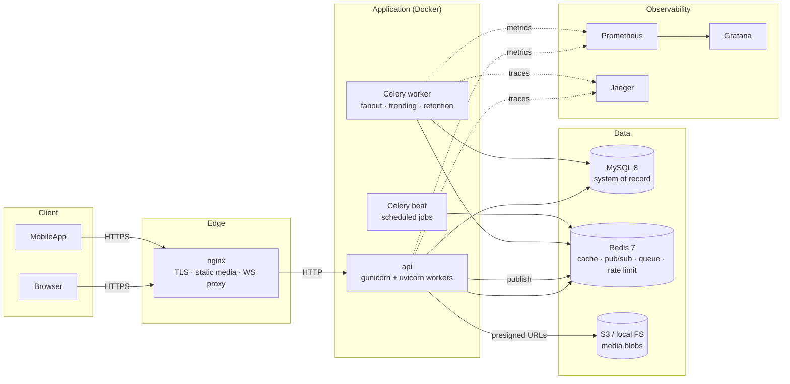
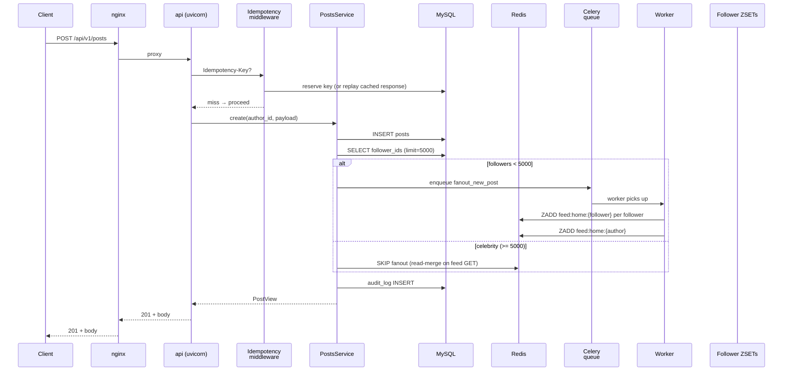
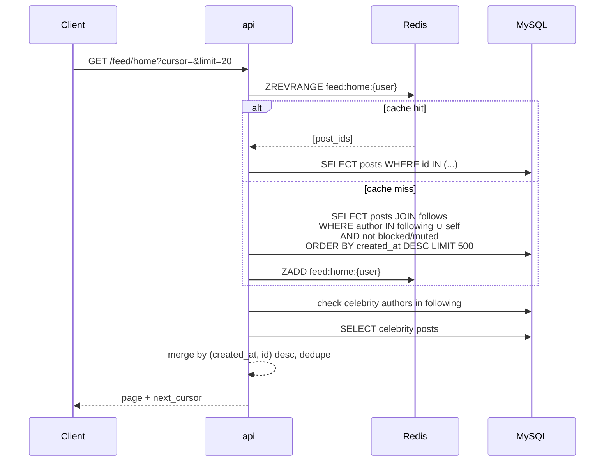

# Architecture

Social API is a **modular monolith** — a single deployable unit with strict internal module boundaries. Designed to run at 1M users on a single MySQL primary + Redis replica set, and to be split into services later without rewriting domain code.

## System context



## Why modular monolith

| Concern | Monolith | Microservices |
|---|---|---|
| Deploy | 1 image | 15 images + orchestration |
| Transaction | Free (same DB) | Distributed saga or 2PC |
| Latency | Function call | Network + serialization |
| Debug | Single log stream | Distributed tracing required |
| Team size (ours) | 1 backend dev | 5+ teams |
| First ship | Days | Weeks |

See [ADR-001](adr/001-modular-monolith.md) for the full reasoning.

## Modules

```
src/social_api/
├── core/               # cross-cutting primitives (security, pagination, docs, flags)
├── db/                 # SQLAlchemy base, session, mixins, custom types
├── cache/              # Redis client + key naming
├── observability/      # metrics, tracing, health
├── realtime/           # ConnectionManager + Redis pub/sub bridge
├── media/              # storage abstraction (local / S3)
├── modules/            # feature modules (one per capability)
│   ├── auth/           # register/login/refresh/logout, JWT
│   ├── users/          # profile, consent, PII
│   ├── follows/        # follow/block/mute + cursor pagination
│   ├── posts/          # posts (visibility, optimistic lock, delete)
│   ├── comments/       # nested comments (depth ≤ 2)
│   ├── likes/          # polymorphic likes (post | comment)
│   ├── feed/           # home (fanout) + explore (trending)
│   ├── notifications/  # inbox + WS push (idempotent, dedupe by day)
│   ├── chat/           # 1-1 + group, media messages, read receipts
│   ├── presence/       # online/offline (Redis counter)
│   ├── moderation/     # reports + moderator queue
│   ├── audit/          # PII-redacted action trail
│   ├── idempotency/    # Idempotency-Key middleware
│   └── gdpr/           # export, delete lifecycle, retention
├── workers/            # celery_app + task modules
└── api/v1/             # FastAPI routers (thin — delegate to services)
```

**Rules:**
- Modules cannot import each other's **routers**; only **services** and **schemas**.
- Cross-module writes go through services, never repos.
- Every module has `models.py`, `schemas.py`, `repository.py`, `service.py`, `router.py` (the pattern enforced by reviewers).

## Data flow: POST /api/v1/posts

This is the most architecturally-complex path. The diagram shows how the request flows and where side effects happen.



**Key invariants:**
- The post row is committed **before** the fanout task is enqueued. If the worker is down, the post still exists; only fanout is delayed.
- Celebrity path (>=5000 followers) skips write-fanout entirely; the feed merges their recent posts at read time.
- Idempotency key is stored in MySQL (survives Redis outage).

## Data flow: GET /api/v1/feed/home



**Key invariants:**
- Cache holds **raw post IDs** (post-visible only). Visibility filter (private/followers) is applied at read time — this makes following/unfollowing immediately consistent without cache busting.
- Celebrity posts are never in the ZSET; they're merged from a fresh DB query on every page 1.
- Cursor is `(created_at DESC, id DESC)` — tamper-evident (HMAC), opaque (base64).

## Scaling path (target: 1M users)

| Concern | Today | At 10× | At 100× |
|---|---|---|---|
| MySQL | single primary | read replicas | shard by user_id |
| Redis | single instance | sentinel + replicas | Redis Cluster |
| Fanout | Celery + Redis queue | dedicated fanout pool | dedicated Kafka topic |
| Media | local FS / S3 | S3 + CloudFront | S3 + multi-region |
| WebSocket | in-process + Redis pub/sub | same (worker per pod) | dedicated WS service |
| Sessions | JWT + JTI blacklist | same | same |

The monolith scales **vertically first** (~5K RPS on one node is achievable) and **horizontally** for the API layer (stateless behind nginx). When a specific module becomes the bottleneck, extract it — the module boundaries are already there.

## Non-goals

- **No microservices (yet).** Splitting now would add operational cost without capability gain at our scale.
- **No Kafka.** Redis pub/sub + Celery cover our event volume; Kafka is a future replacement when ordering / replayability matters (see `docs/adr/003-hybrid-feed-fanout.md`).
- **No Kubernetes.** Docker Compose is sufficient for both dev and single-host prod; k8s arrives when multi-region is needed.
